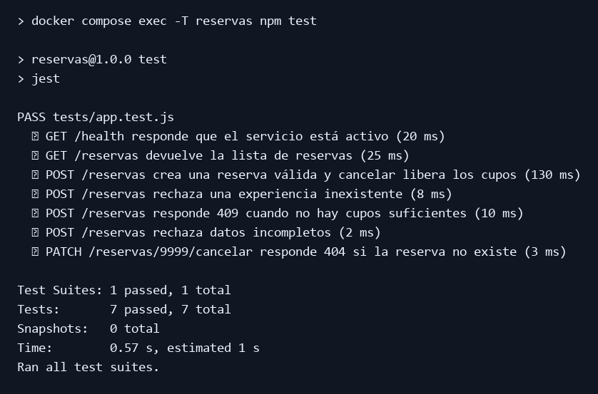
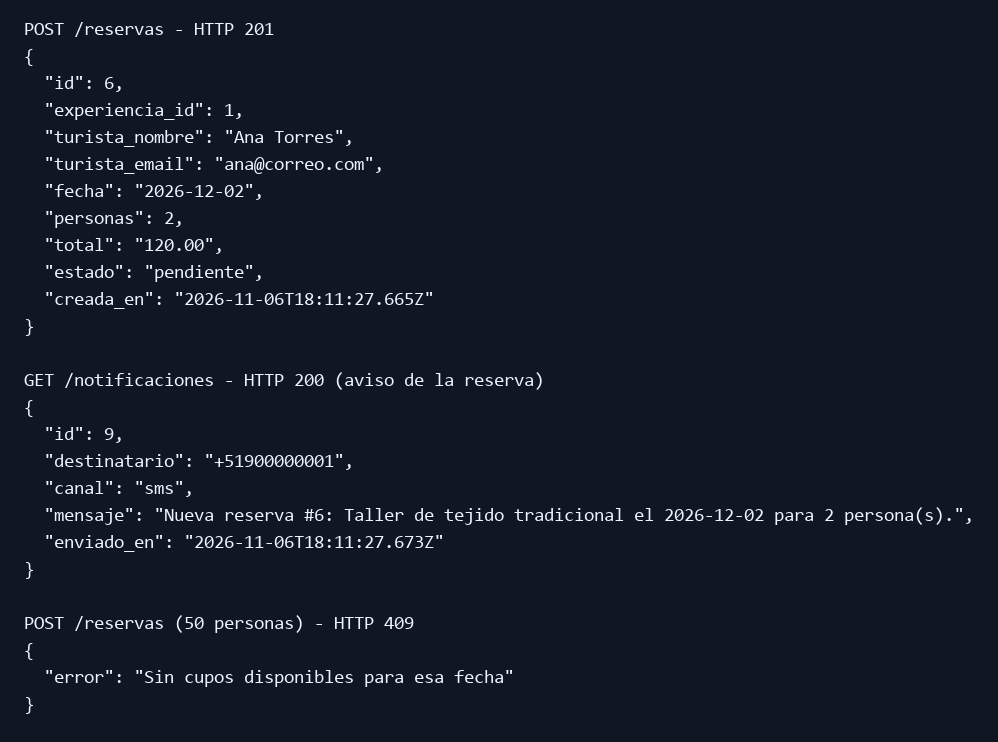

# Pruebas del microservicio Reservas

**Responsable:** MARIANO JHOSHUA LAURA PAZ
**Puerto:** 3004 · **Comando:** `docker compose exec reservas npm test`

| Microservicio | Prueba | Qué verifica | Resultado esperado |
|---|---|---|---|
| Reservas | GET /health responde que el servicio está activo | El servicio responde | 200 y `servicio: reservas` |
| Reservas | GET /reservas devuelve la lista | Consulta de todas las reservas | 200 y una lista con datos |
| Reservas | POST /reservas crea una reserva y cancelar libera los cupos | **Flujo completo entre servicios** (Experiencias, Disponibilidad, Notificaciones) | 201, estado `pendiente`, total 80; al cancelar, estado `cancelada` y los cupos vuelven |
| Reservas | POST /reservas rechaza una experiencia inexistente | **Comunicación con Experiencias** | 400 "La experiencia indicada no existe" |
| Reservas | POST /reservas responde 409 sin cupos suficientes | **Comunicación con Disponibilidad** | 409 |
| Reservas | POST /reservas rechaza datos incompletos | Validación de datos | 400 |
| Reservas | PATCH /reservas/9999/cancelar responde 404 | Cancelar una reserva inexistente | 404 |

## Ejecución de las pruebas

## Prueba manual de la API

Las imágenes reproducen la salida de Jest y las respuestas HTTP de la ejecución local con Docker Compose.
